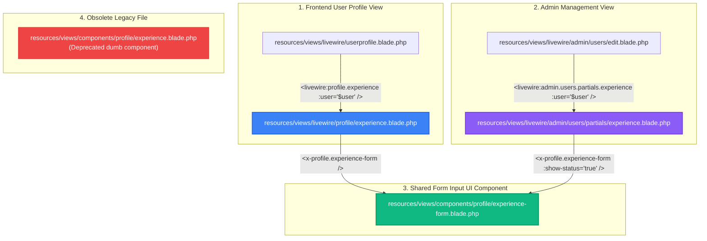

# Experience Components Architecture & Relationship Guide

> **Context**: This document explains the purpose, connections, differences, and lifecycle of the **4 experience-related files** in the Scholar9 application, clarifying why they exist, how they interact, and which files are active vs. obsolete.

---

## 1. Executive Summary

In Scholar9, user work experiences appear in two distinct interfaces:
1. **The User Profile Page** (`/profile/{slug}`) – For public viewing and user self-management.
2. **The Admin User Edit Screen** (`/admin/edit_users/{user}`) – For administrators managing user records and account statuses.

To prevent duplicated UI code while maintaining complete backend isolation and error boundary protection, the experience feature is structured into **independent child Volt components** backed by a **shared form component**.

| # | File Path | Component Type | Primary Purpose | Status |
|---|-----------|----------------|-----------------|:------:|
| **1** | [`resources/views/components/profile/experience-form.blade.php`](file:///c:/Users/hp/Desktop/L12S9/resources/views/components/profile/experience-form.blade.php) | **Shared Blade Component** | Reusable modal input form (Designation, Organization with live API suggestions, Dates, Description, and Admin status switch). | **ACTIVE (Shared UI)** |
| **2** | [`resources/views/livewire/profile/experience.blade.php`](file:///c:/Users/hp/Desktop/L12S9/resources/views/livewire/profile/experience.blade.php) | **Livewire Volt Child Component** | User Profile Experience timeline with error boundary, active-only record filtering, and owner edit actions. | **ACTIVE (User Facing)** |
| **3** | [`resources/views/livewire/admin/users/partials/experience.blade.php`](file:///c:/Users/hp/Desktop/L12S9/resources/views/livewire/admin/users/partials/experience.blade.php) | **Livewire Volt Child Component** | Admin User Experience management with error boundary, both active & inactive records, and status toggles. | **ACTIVE (Admin Panel)** |
| **4** | `resources/views/components/profile/experience.blade.php` | **Old Dumb Blade Component** | Legacy wrapper originally used before Volt child component modularization. | **DELETED / REMOVED** |

---

## 2. Component Relationship Diagram

---

## 3. Detailed File Analysis

### File 1: Shared Input Form Component
- **File**: [`resources/views/components/profile/experience-form.blade.php`](file:///c:/Users/hp/Desktop/L12S9/resources/views/components/profile/experience-form.blade.php)
- **Role**: Reusable form UI partial.
- **Why it exists**: Instead of duplicating 300+ lines of HTML form inputs (Designation autocomplete input, Organization autocomplete input, Start/End dates, "Currently working" toggle, Description textarea, and Alpine client validation), this single Blade component handles the form presentation for **both** user and admin contexts.
- **Key Props**:
  - `showStatus` (boolean, default: `false`): Enables or disables the Admin Status radio buttons (`Active` / `Inactive`).
  - `itemId` (string): Distinct identifier for Alpine modal keying.

---

### File 2: User Profile Experience Component
- **File**: [`resources/views/livewire/profile/experience.blade.php`](file:///c:/Users/hp/Desktop/L12S9/resources/views/livewire/profile/experience.blade.php)
- **Parent**: Embedded in [`resources/views/livewire/userprofile.blade.php`](file:///c:/Users/hp/Desktop/L12S9/resources/views/livewire/userprofile.blade.php)
- **Role**: Self-contained Livewire Volt child component for user-facing profile.
- **Capabilities**:
  - **Public filtering**: Only fetches and displays **active** (`status == 1`) records for visitors.
  - **Ownership check**: Displays Add/Edit/Delete buttons only when `$isOwnProfile` is `true`.
  - **Isolated state**: Owns `$experiences`, `saveExperience()`, and `deleteExperience()`, preventing state pollution in the main `userprofile.blade.php`.
  - **Error Boundary**: Has an `exception()` hook; if database access or JSON decoding fails, a friendly fallback card is displayed and other profile sections (About, Education, Publications) remain completely functional.

---

### File 3: Admin Edit Experience Component
- **File**: [`resources/views/livewire/admin/users/partials/experience.blade.php`](file:///c:/Users/hp/Desktop/L12S9/resources/views/livewire/admin/users/partials/experience.blade.php)
- **Parent**: Embedded in [`resources/views/livewire/admin/users/edit.blade.php`](file:///c:/Users/hp/Desktop/L12S9/resources/views/livewire/admin/users/edit.blade.php)
- **Role**: Self-contained Livewire Volt child component for admin user editing.
- **Capabilities**:
  - **Comprehensive view**: Displays **all** experiences (both active `1` and inactive `0`).
  - **Admin controls**: Includes filter tabs (`All`, `Active`, `Inactive`) and direct status toggling (`toggleExperienceStatus`, `setExperienceStatus`).
  - **Status override**: Uses `<x-profile.experience-form :show-status="true" />` so admins can explicitly set status during creation or modification.
  - **Error Boundary**: If an experience query fails, it catches the error and keeps the remaining admin tabs and forms operational.

---

### File 4: Obsolete Legacy Component
- **File**: `resources/views/components/profile/experience.blade.php`
- **Role**: Old Blade component created during early development.
- **Why it was replaced**: This file was a "dumb" Blade component (`@props(['experiences'])`) requiring the parent component (`userprofile.blade.php`) to host 200+ lines of CRUD methods, timeline queries, and state management. When `userprofile.blade.php` grew beyond 1,500 lines, this component was superseded by the modern Volt child component (File #2).
- **Current status**: **DELETED**. Safely removed to eliminate code duplication and confusion.

---

## 4. Key Differences: User Profile vs. Admin Edit

| Feature | User Profile Experience (File #2) | Admin Edit Experience (File #3) |
|---|---|---|
| **Viewed By** | Public visitors & Logged-in Profile Owner | System Administrators only |
| **Visible Records** | Active records only (`status = 1`) | All records (`status = 1` and `status = 0`) |
| **Filter Tabs** | None (clean timeline) | `All`, `Active`, `Inactive` tabs |
| **Status Switcher** | Hidden | Interactive Active/Inactive toggle buttons |
| **Form Status Field** | Hidden | Visible (`:show-status="true"`) |
| **Error Boundary** | Graceful user notice + support link | Graceful admin notice with warning icon |

---

## 5. Clean Code Recommendations

1. **Obsolete File Removed**:
   - `resources/views/components/profile/experience.blade.php` has been successfully deleted.
2. **Maintain Single Root Element in Volt Components**:
   - Any child Volt component must enclose its template in a top-level `
` tag so Livewire's nesting engine can parse the root DOM node without conflicts.
3. **Keep Form Inputs Shared**:
   - Any adjustments to experience form fields (e.g. character limits or helper text) should be made in [`experience-form.blade.php`](file:///c:/Users/hp/Desktop/L12S9/resources/views/components/profile/experience-form.blade.php) so both the user profile and the admin panel remain synchronized automatically.
