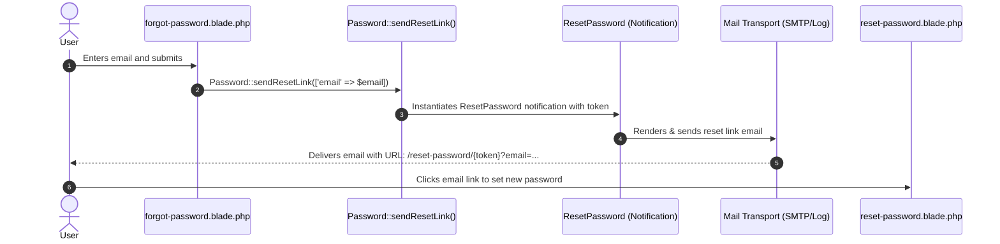

# Section 1: Password Reset Mail

## 1. Overview
When a user forgets their password, they can request a temporary password reset link delivered to their registered email address.

---

## 2. Condition & Trigger

- **Trigger:** A guest navigates to `/forgot-password` (named route: `password.request`).
- **Condition:** 
  1. The user inputs their email address.
  2. Input passes validation: `required|string|email`.
  3. The user clicks **"Email password reset link"** button.
  4. The email address must match an existing account in the MongoDB `users` collection. (If not found, a generic success response is shown to prevent account enumeration).

---

## 3. File Flow & Execution Path



### Source File:
- **File:** [`resources/views/livewire/auth/forgot-password.blade.php`](file:///c:/Users/hp/Desktop/L12S9/resources/views/livewire/auth/forgot-password.blade.php#L13-L22)
- **Code:**
  ```php
  public function sendPasswordResetLink(): void
  {
      $this->validate([
          'email' => ['required', 'string', 'email'],
      ]);

      Password::sendResetLink($this->only('email'));

      session()->flash('status', __('A reset link will be sent if the account exists.'));
  }
  ```

### Handling & Target Destination:
- **Notification Sent:** `Illuminate\Auth\Notifications\ResetPassword`
- **Route Generated:** `password.reset` (`/reset-password/{token}`)
- **Destination Component:** [`resources/views/livewire/auth/reset-password.blade.php`](file:///c:/Users/hp/Desktop/L12S9/resources/views/livewire/auth/reset-password.blade.php)
- **Route Definition:** [`routes/auth.php`](file:///c:/Users/hp/Desktop/L12S9/routes/auth.php#L18)

---

## 4. Test Verification
The password reset email flow is tested in Pest:
- **File:** [`tests/Feature/Auth/PasswordResetTest.php`](file:///c:/Users/hp/Desktop/L12S9/tests/Feature/Auth/PasswordResetTest.php#L14-L24)
- **Assertion:** `Notification::assertSentTo($user, ResetPassword::class);`

