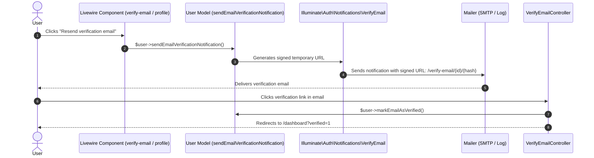

# Section 2: Email Verification Mail

## 1. Overview
Email verification ensures that the email address associated with the user account belongs to the user and can receive important system communications.

---

## 2. Triggers & Conditions

There are three entry points related to Email Verification:

### Flow A: Resend from Verification Notice Screen (`/verify-email`)
- **Condition:** 
  1. The user must be authenticated (`middleware('auth')`).
  2. The user has not yet verified their email (`$user->hasVerifiedEmail() == false`).
  3. The user clicks **"Resend verification email"**.
- **Source File:** [`resources/views/livewire/auth/verify-email.blade.php`](file:///c:/Users/hp/Desktop/L12S9/resources/views/livewire/auth/verify-email.blade.php#L13-L24)
- **Code:**
  ```php
  public function sendVerification(): void
  {
      if (Auth::user()->hasVerifiedEmail()) {
          $this->redirectIntended(default: route('dashboard', absolute: false));
          return;
      }

      Auth::user()->sendEmailVerificationNotification();

      Session::flash('status', 'verification-link-sent');
  }
  ```

---

### Flow B: Resend from User Profile Settings (`/settings/profile`)
- **Condition:**
  1. The user is logged in and navigates to the profile settings tab.
  2. The user changes their email address or is unverified.
  3. The user clicks the link **"Click here to re-send the verification email."**.
- **Source File:** [`resources/views/livewire/settings/profile.blade.php`](file:///c:/Users/hp/Desktop/L12S9/resources/views/livewire/settings/profile.blade.php#L57-L70)
- **Code:**
  ```php
  public function resendVerificationNotification(): void
  {
      $user = Auth::user();

      if ($user->hasVerifiedEmail()) {
          $this->redirectIntended(default: route('dashboard', absolute: false));
          return;
      }

      $user->sendEmailVerificationNotification();

      Session::flash('status', 'verification-link-sent');
  }
  ```
> **Note on Visibility:** In `profile.blade.php` (line 83), the prompt is wrapped with:
> `@if (auth()->user() instanceof \Illuminate\Contracts\Auth\MustVerifyEmail && ! auth()->user()->hasVerifiedEmail())`
> Because `implements MustVerifyEmail` is commented out on `App\Models\User`, this button is hidden unless `MustVerifyEmail` is implemented.

---

### Flow C: Auto-Send on User Registration (`/register`)
- **Condition:**
  1. Guest registers at `/register`.
  2. The `Registered` event is fired:
     ```php
     event(new Registered(($user = User::create($validated))));
     ```
- **Source File:** [`resources/views/livewire/auth/register.blade.php`](file:///c:/Users/hp/Desktop/L12S9/resources/views/livewire/auth/register.blade.php#L30)
- **Status in Current Codebase:**
  - In [`app/Models/User.php`](file:///c:/Users/hp/Desktop/L12S9/app/Models/User.php#L16):
    ```php
    class User extends Authenticatable // implements MustVerifyEmail
    ```
  - Laravel's built-in `SendEmailVerificationNotification` listener checks if `$user instanceof MustVerifyEmail`. Since it is commented out, auto-sending verification on registration is **inactive**.
  - **To enable auto-send on registration:** Uncomment `implements MustVerifyEmail` in [`app/Models/User.php`](file:///c:/Users/hp/Desktop/L12S9/app/Models/User.php#L16).

---

## 3. Email Verification Delivery & Verification Flow



### Destination & Verification Handler:
- **Destination Controller:** [`app/Http/Controllers/Auth/VerifyEmailController.php`](file:///c:/Users/hp/Desktop/L12S9/app/Http/Controllers/Auth/VerifyEmailController.php)
- **Route Definition:** [`routes/auth.php`](file:///c:/Users/hp/Desktop/L12S9/routes/auth.php#L27-L29)
  ```php
  Route::get('verify-email/{id}/{hash}', VerifyEmailController::class)
      ->middleware(['signed', 'throttle:6,1'])
      ->name('verification.verify');
  ```
- **Result:** Sets `email_verified_at = now()` on the MongoDB user document and fires the `Illuminate\Auth\Events\Verified` event.

---

## 4. Test Verification
The verification routes and hash verification logic are tested in Pest:
- **File:** [`tests/Feature/Auth/EmailVerificationTest.php`](file:///c:/Users/hp/Desktop/L12S9/tests/Feature/Auth/EmailVerificationTest.php)

